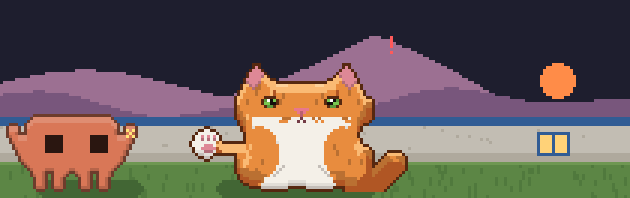

# claude-cretan-cat

Manousos is a Cretan cat who lives above your Claude Code prompt.

While Claude works, Clawd nudges him about your task, and Manousos answers in
song: Cretan *mantinades* by default, or Spanish coplas, or English couplets.
He pounces on tools, dances when the tests go green, catches a sardine for
every commit, and purrs when the work is done. Behind them stands Psiloritis,
under the sun or the moon as your clock says.


He is drawn after a real cat: dark brown long hair, a white bib and white
mittens.

- **Free to run.** No model calls and no network requests: everything is drawn
  locally from what Claude Code is already doing.
- **Independent.** Not affiliated with or endorsed by Anthropic.

## Quick start

You need Claude Code with plugin hook modules, an early-access feature (built
and tested on 2.1.299). At the prompt:

```text
/plugin install cretan-cat --marketplace jmoschon/claude-cretan-cat
```

Answer `y` to add the marketplace and pick a scope (user scope brings him to
every session). He moves in straight away. Rather run it from a clone? See
[running from source](docs/development.md#running-from-source).

## What he does

| When                    | Manousos                                    |
| ----------------------- | ------------------------------------------- |
| Nothing is running      | Sleeps curled up on his cushion             |
| Claude is thinking      | Paces the lawn, singing, while Clawd nudges |
| Claude runs a tool      | Crouches, wiggles, pounces                  |
| Claude needs you        | Sits up and looks at you, `?` overhead      |
| Tests pass (or fail)    | Dances (or hisses)                          |
| A commit goes in        | Catches Clawd's sardine and eats it         |
| The work is done        | Sits, purrs and sings                       |

Kittens, dozing off, petting and the yard through the day are all in
[how he behaves](docs/behaviour.md).

## Commands

```text
/cat                    hide him, or bring him back
/cat pet                pet him (treat and play too)
/cat ginger             a coat: ginger, tuxedo (/cat coat manousos)
/cat small, /cat dock   just the cat, in a square or a pane on the right
/cat asturias           his sister; /cat manousos brings him back
/cat name Kostis        call him something else
/cat songs spanish      what he sings
/cat stats              sardines, pets and his rank
/cat config             every setting and what it is now
/cat help               all of it
```

The full list, with what `/cat help`, `/cat config` and `/cat stats` print, is
in [commands](docs/commands.md).

## Settings

All of these are under `/config`, "Cretan cat" (and on the screen that
installs him), and each has a `/cat` command too.

| Setting          | Values                                                       | Default    |
| ---------------- | ------------------------------------------------------------ | ---------- |
| name             | any name, up to 20 characters                                | `Manousos` |
| coat             | `manousos`, `ginger`, `tuxedo`                               | `manousos` |
| Clawd's language | `greek`, `english`, `spanish` (as in Buenos Aires)           | `greek`    |
| songs            | `greek`, `english`, `spanish`                                | `greek`    |
| temper           | `off`, `on`: he slaps, swats and naps on your keys           | `off`      |
| sound            | `off`, `on`: a trill, a mew, a purr, a hiss (macOS)          | `off`      |
| resolution       | `low`, `high`: a sharper yard in kitty and Ghostty terminals | `low`      |
| where he lives   | `band`, `small`, `dock`                                      | `band`     |
| hints            | `on`, `off`: the /cat tips under the napping cat             | `on`       |
| ai               | `off`, `on`: songs and nudges written for each prompt by one small Haiku call a turn (tokens; at most 100 a day; only the topic words are sent, [details](docs/settings.md#ai-songs-and-lines)) | `off` |

The GIF above is `resolution: high`; [this one](docs/demo-low.gif) is how
`low` looks. Every setting in detail is in [settings](docs/settings.md).

> **Recommended terminal: [cmux](https://cmux.com).** It's where
> `resolution: high` was built and tested, and where Manousos looks his
> best. Any kitty or Ghostty terminal works too; everywhere else he keeps
> his classic look.

## Meet Asturias



Want the full ginger-cat experience? Meet **Asturias**, Manousos's sister,
who came home from across the sea with a big attitude.

```text
/cat asturias
```

- **Ginger,** from whiskers to tail.
- **Sings coplas and tangos,** not mantinades: payador verses bent to the
  work, and the odd *Volver* about the ticket left in Review.
- **Clawd talks to her in rioplatense,** and she answers in it: *¿Qué
  querés?*, *Yo no fui, che*, *¿Sardina? ¿Y el asado?*
- **Temper always on.** Nag her and she slaps Clawd. Pet her and you may
  get swatted. Some turns she's asleep on your keyboard before Claude gets
  there.

She doesn't take orders from anyone, least of all Clawd. When you've had
enough, `/cat reset` brings Manousos back, calm and Greek.

## More

- [How he behaves](docs/behaviour.md): nudges, orders, sardines, naps, kittens,
  petting, the yard from dawn to night, and how he fits a small terminal.
- [Commands](docs/commands.md): every `/cat` command and what it prints.
- [Settings](docs/settings.md): each setting, the temper, sound, and how
  `resolution: high` decides whether your terminal can show the picture.
- [Troubleshooting](docs/troubleshooting.md): when he doesn't show up, sit up
  or make a sound.
- [Development](docs/development.md): running from source, tests, the files,
  and how the sounds and these GIFs are made.

## License

MIT. See [LICENSE](LICENSE).
