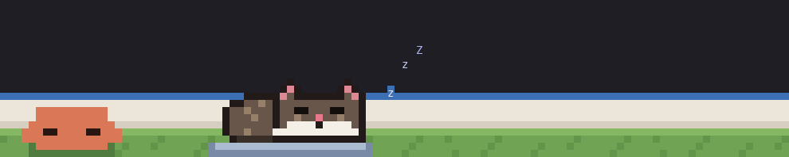

# claude-cretan-cat

Manousos, a Cretan cat, lives above your Claude Code prompt. While Claude
works, Clawd tells him what to do, and Manousos answers in mantinades, the
rhyming couplets of Crete. When the work is done he sits and purrs; when
nothing is happening he sleeps on his cushion.



He is drawn after a real cat: dark brown long hair, a white bib and white
mittens.

It costs nothing to run. There are no model calls and no network requests;
everything is drawn locally from what Claude Code is already doing.

An independent project, not affiliated with or endorsed by Anthropic.

## What he does

| When | Manousos | Clawd |
|---|---|---|
| Nothing is running | Sleeps curled up on his cushion | Dozes |
| Claude is thinking | Paces the lawn, singing a mantinada | Nudges him about your task: *How's "checkout tests" going, Manousos?* |
| Claude runs a tool | Crouches, wiggles, pounces | Gives the order for that tool: *Run the command!*, *Read the file!* |
| The work is done | Sits, wags his tail, sings one more couplet | Cheers |
| Something failed | Jumps, tail puffed up | Asks what happened |
| You pressed Esc | Goes back to sleep | Dozes |

The topic Clawd mentions is picked from the last meaningful words of your
prompt. Slash commands are never picked up.

## Install

You need Claude Code with plugin hook modules, an early-access feature. This
was built and tested on version 2.1.299.

At the Claude Code prompt:

```
/plugin install cretan-cat --marketplace jmoschon/claude-cretan-cat
```

Answer `y` to add the marketplace, then pick a scope (user scope loads him in
every session). He appears above the prompt straight away.

### From source

```sh
git clone https://github.com/jmoschon/claude-cretan-cat ~/src/claude-cretan-cat
claude --plugin-dir ~/src/claude-cretan-cat
```

To load it in every session, add the folder to the `env` block of
`~/.claude/settings.json` with its full path, then restart Claude Code:

```json
{
  "env": {
    "CLAUDE_CODE_PLUGIN_DIRS": "/Users/you/src/claude-cretan-cat"
  }
}
```

To update, run `git pull` in the folder.

## Commands and settings

| Command | What it does |
|---|---|
| `/cat` | Hide him, or bring him back. |
| `/cat manousos` | The original coat: dark brown with a white bib and mittens. |
| `/cat ginger` | An orange tabby. |
| `/cat tuxedo` | Black and white. |
| `/cat help` | Lists the coats and where the language setting is. |

The coat you pick is remembered across sessions.

One setting, under `/config` as "Cretan cat: language":

| Setting | Values | Default |
|---|---|---|
| Language | `greek`, `english`, `spanish` | `greek` |

It sets the language of what Clawd says and of Manousos' short replies. The
mantinades are always in Greek; they are Cretan songs, and they stay that way.

## Room it needs

The full scene is 11 rows plus a caption line, in a terminal at least about
83 columns wide.

- With less height, Clawd's speech bubble is left out and the yard keeps its
  8 rows.
- With less width, the mantinada moves out of its bubble and shows as text
  under the yard.
- Outside the terminal (the desktop app), he is drawn as an ASCII cat with
  his caption beside him.

## Troubleshooting

**Nothing shows up.** Run `claude --debug` and look for lines starting with
`cretan-cat`. If they say hook modules are turned off, your Claude Code
doesn't have the feature yet.

**He disappeared.** You may have hidden him: type `/cat`.

## Development

```sh
claude plugin validate .   # what the engine will load, and anything it would refuse
claude plugin test .       # tests/cat.test.ts against the engine
npx -p typescript tsc -p . # types (Claude Code writes .claude-plugin/types/ when it loads the plugin)
```

Files:

- `hooks/register.tsx`: the hooks. Watches prompts, turns and tool calls,
  keeps the cat's mood, and draws the band above the prompt.
- `hooks/manousos.ts`: draws the scene as pixels, two to a terminal cell.
- `hooks/sprites.ts`: Manousos, pose by pose, as letter grids, and his coats.
- `hooks/lines.ts`: what Clawd and Manousos say, per language, and how the
  topic is picked from a prompt.
- `hooks/clawd.ts`: Clawd, from claude-toons.

To redraw `docs/demo.gif` (needs Pillow):

```sh
npx tsx scripts/frames.ts > /tmp/frames.jsonl
python3 scripts/gif.py /tmp/frames.jsonl docs/demo.gif
```

## Credits

Clawd's sprite (`hooks/clawd.ts`) comes from
[claude-toons](https://github.com/achimala/claude-toons) by Anshu Chimala,
under the MIT license. That project is also where the idea of a cartoon
above the prompt comes from.

## License

MIT. See [LICENSE](LICENSE).
