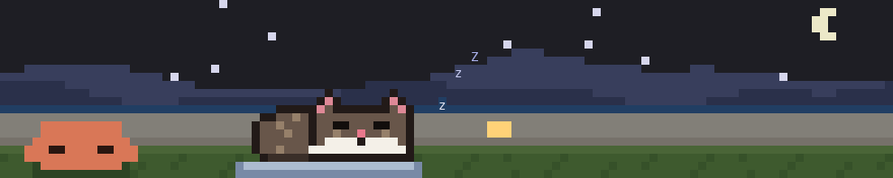

# Settings

[Back to the README](../README.md)

Every setting is a row under `/config`, "Cretan cat", and on the screen that
installs him. Each has a `/cat` command that changes the same row, so the two
never disagree: `/cat name`, `/cat coat` (or `/cat ginger`, `/cat tuxedo`),
`/cat language`, `/cat songs`, `/cat temper`, `/cat sound`,
`/cat resolution`, `/cat band|small|dock`, `/cat hints` and `/cat ai`. A row your
organization has locked keeps its value, and `/cat` says so. Whether he is
hidden, his sardines and his pets are remembered across sessions too.

Up to 1.10 the coat, where he lives and the hints were kept apart from the
settings, in the plugin's own store. The first session after the update
moves what you picked into them, once, writing their `/config` rows where it
can (a locked row keeps its value): a cat you dressed in the ginger coat
stays ginger.

| Setting (`/config`)           | Values                          | Default    | `/cat` command                  |
| ----------------------------- | ------------------------------- | ---------- | ------------------------------- |
| Cretan cat: his name          | any name, up to 20 characters   | `Manousos` | `/cat name <name>`              |
| Cretan cat: coat              | `manousos`, `ginger`, `tuxedo`  | `manousos` | `/cat coat <coat>`, `/cat ginger` |
| Cretan cat: what Clawd speaks | `greek`, `english`, `spanish`   | `greek`    | `/cat language <language>`      |
| Cretan cat: what he sings     | `greek`, `english`, `spanish`   | `greek`    | `/cat songs <language>`         |
| Cretan cat: temper            | `off`, `on`                     | `off`      | `/cat temper on\|off`           |
| Cretan cat: sound             | `off`, `on`                     | `off`      | `/cat sound on\|off`            |
| Cretan cat: resolution        | `low`, `high`                   | `low`      | `/cat resolution low\|high`     |
| Cretan cat: where he lives    | `band`, `small`, `dock`         | `band`     | `/cat band\|small\|dock`         |
| Cretan cat: hints             | `on`, `off`                     | `on`       | `/cat hints on\|off`            |
| Cretan cat: AI songs          | `off`, `on`                     | `off`      | `/cat ai on\|off`               |

`/cat config` lists them all with what they are now
([example](commands.md#cat-config)).

## Name

What the cat is called, in the caption and by Clawd. In Greek, Clawd calls
Manousos *Μανούσο* and Asturias *Αστούριας*, and any other name as you wrote
it.

## Coat

His fur: `manousos` is dark brown long hair with a white bib and white
mittens, `ginger` an orange tabby, `tuxedo` black and white. `/cat coat
<coat>`, or just `/cat ginger` or `/cat tuxedo`, changes it and brings him out
from under the sofa. `/cat manousos` is the whole cat as he came, not just
the coat; `/cat asturias` puts her in the ginger coat.

## Clawd's language

What Clawd says, and the cat's short replies. Spanish is the Spanish of
Buenos Aires (*¡Dale Manousos, arrancamos!*), and the cat answers in it the
way Asturias does. A `/config` row still set to `rioplatense`, from an older
version, reads as `spanish`.

## Songs

What the cat sings while Claude works: Cretan mantinades, payador coplas and
the odd tango, or English rhyming couplets, all bent to the work. Each set
stays in its own language, whatever Clawd speaks.

## Temper

With the temper on, the cat has opinions:

- **Nag him and he bites back.** Each time Clawd nudges him while Claude
  thinks, he may slap Clawd (*Stop nagging!*) or ignore him altogether
  (*Nope.*).
- **Petting him** sometimes gets you a swat instead of a purr.
- **The fishing toy.** About one time in three he won't play: he curls up
  and looks the other way, or turns around, tail up, and shows you his butt.
- **Your keyboard.** Some turns he gets there before Claude does, lies down
  on it and asks for cuddles, while Clawd tells him to get off. Pet him and
  he gets off; otherwise he stays until the turn ends, so when you're idle he
  naps as usual. Nothing is held up: it's only his side of the yard, and he
  gets up whenever Claude needs you, something fails or the tests finish.

## Sound

Turned on, the cat has a voice:

- a happy *mrrp!* when the work is done or a sardine lands,
- a questioning *mew?* when Claude is waiting for you (a permission prompt,
  a question, a plan to approve),
- a purr when you pet him,
- a short hiss when the tests fail or he swats your hand,
- the fishing toy's bell, a little cascabel, when you dangle it.

Never more than one sound every two seconds, so a burst of events is one
sound, not a chorus. The *mew?* is the exception: it tells you Claude is
waiting, so it always plays. Claude Code plays the sounds with `afplay`, so on
macOS only; a Linux or Windows terminal stays quiet. `/cat sound on` or `off`
changes it, as `/config` does.

## Resolution

How finely the yard is drawn.

- **`low`** (the default): two pixels to a terminal cell, using half-block
  characters. It works in every terminal. This is how it looks:

  

- **`high`**: the yard as a real picture, three times as fine each way, the
  way the [GIF in the README](../README.md) shows it. Clawd and the cat are
  drawn from finer art, and the mountains, wall, window, lawn, cushion and
  shadows are painted again at that density. The words (both bubbles, the
  dotted line to his, the marks by his head) stay as text laid over the
  picture. The picture repaints about five times a second, and only what
  changed.

`/cat resolution high` or `/cat resolution low` switches it, or `/config`.
`/cat reset` and `/cat asturias` leave it as it is.

### Where high shows

We recommend **[cmux](https://cmux.com)**, where `high` was built and tested
(it runs on Ghostty). Only a terminal that shows pictures can draw it: **kitty** or **Ghostty**,
and not inside **tmux** or **screen**, which pass no pictures through.
Elsewhere `high` quietly draws the usual cells, so it is safe to leave on.
The desktop app always draws its SVG, and a terminal too small for the yard
gets the ASCII cat, whatever the resolution.

The plugin decides once per session, from the environment Claude Code was
started in:

- **kitty or Ghostty:** `TERM` is `xterm-kitty` or `xterm-ghostty`, or
  `TERM_PROGRAM` is `kitty` or `ghostty`, or `KITTY_WINDOW_ID` or
  `GHOSTTY_RESOURCES_DIR` is set.
- **Multiplexed (no pictures):** `TMUX` or `STY` is set, `TERM` starts with
  `screen` or `tmux`, or `TERM_PROGRAM` is `tmux`.

If the terminal turns the picture down anyway (three refusals in a row, or
one that says it is drawing the placeholder text instead), he goes back to
cells for the rest of the session.

### Is the picture on?

`/cat config` tells you. With `resolution: high`, its last row reads one of:

| `/cat config` says                                         | Meaning                                                                    |
| ---------------------------------------------------------- | -------------------------------------------------------------------------- |
| `high (pictures)`                                          | The yard is a picture.                                                     |
| `high, in cells: not drawn yet`                            | The band hasn't been drawn since the plugin loaded.                        |
| `high, in cells: pictures not detected (TERM=… TERM_PROGRAM=…)` | Not kitty or Ghostty, or under tmux or screen; the variables it saw follow (and `GHOSTTY`, `KITTY`, `TMUX`, `SCREEN` when those were set). |
| `high, in cells: the terminal refused the picture: …`      | The terminal said no; its reason follows. Cells for the rest of the session. |
| `high, in cells: this terminal surface has no Image element` | This Claude Code can't place pictures above the prompt.                  |
| `high, in cells: the desktop draws cells`                  | The desktop app (or any other surface but the terminal) draws its own way. |

## Where he lives

- **`band`** (the default): the whole yard above the prompt, with Clawd and
  the bubbles.
- **`small`**: just the cat, no Clawd and no bubbles, in a small square at the
  right above the prompt.
- **`dock`**: just the cat, in a pane of his own that the fullscreen layout
  docks on the right (elsewhere it sits above the prompt). Closing the pane by
  hand sets it back to `band`.

`/cat band`, `/cat small` and `/cat dock` change it, and bring him out from
under the sofa if he was hiding.

## Hints

On (the default), the napping caption ends with tips: *Manousos is napping ·
/cat help · /cat hide · /cat asturias or manousos swaps the cat*. Off, it just
says he is napping. `/cat hints on` or `off` changes it.

## AI songs and lines

Off unless you turn it on (`/cat ai on`, or `/config`). On, each prompt you
send gets its own words: one small model call (Haiku, through Claude Code's
own client) writes the cat's song and Clawd's nudges about what you asked
for, and with the temper on, the cat's comebacks too. The song is the next
one the cat sings that turn; Clawd's next three nudges are the written ones.
The timing, the moods and everything else stay as they are, and the
built-in lines and songs take over whenever there is nothing written.

**What is sent.** Only:

- the topic: a few words from *your* prompt, the ones the cat already picks
  for Clawd's nudges (*checkout tests*), at most 60 characters. They are
  your own words, so they can include a file, command or project name you
  typed. Before they are picked, these are taken out: anything that looks
  like a key or token (an OpenAI-style, GitHub or AWS key, a JWT, a hex or
  base64-looking run, a word mixing letters and digits), the word after
  *password*, *token*, *key*, *secret*, *auth* and the like, percent-encoded
  text, email addresses, URLs and host names, IP addresses, file paths and
  file names, phone numbers and long numbers, and invisible characters.
  This is a filter, not a guarantee: don't paste secrets into prompts;
- the settings: the cat's name (and what Clawd calls it in Greek), Clawd's
  language, which songs, whether the temper is on, and whether it is
  Asturias;
- a few session facts, as counts, outcomes and coarse time only: the last
  test result this session (green, red or none) and how many red runs
  today; commits this session; how many tool calls the previous turn made,
  whether it finished, failed or was stopped, and how long it took (under
  1 minute, 1 to 5, over 5); the time of day (morning, afternoon, evening,
  late night) and the weekday; today's sardines and pets; whether the cat
  was petted or swatted in the last ten minutes; and whether helpers ran.
  The model may mention one of them, playfully, and is told never to
  invent any.

The session facts never carry a name, a command, a test name, tool output
or a branch or repo name, and nothing is taken from your files, Claude's
answers or the transcript; the whole prompt is never sent, only the topic
words above. A prompt whose topic is empty once cleaned (*hi*) makes no
call. Only a prompt you typed at the prompt between turns makes a call:
not a message from a channel, another session, another plugin, a scheduled
task or a notification, and not one typed into a turn that is running.

The debug log records the topic's length, the session facts and how the
call went (answered or why not, tokens), never the topic or the words
written.

**What it costs.** At most one call per prompt, never from the animation or
a timer, never for a slash command: about 1,000 to 4,500 tokens of Haiku
(Greek songs cost the most), capped at 1,000 output tokens and 15 seconds. At
most 100 calls a day (by your local date), then the built-in lines until
tomorrow. The count is kept per machine, and with several sessions running
at once it can go a few calls over. `/cat stats` shows the day's count, for example
`AI: 12 calls, 4.1k tokens today`.

**Greek songs.** Haiku doesn't compose a mantinada from nothing: it gets
four of the built-in ones with their syllables marked (they turn from call
to call) and an example rewrite, and writes two candidates. Each keeps a
built-in song's rhythm and its two rhyme words (or another easy rhyme pair)
and rewrites the rest about your topic. The first candidate that scans is
sung: 14 to 16 syllables a line counted as the song is sung (αι, ου and the
like as one, -ιά and μια as one, κι before a vowel sung with it), a word
ending near the 8th syllable, the two lines rhyming from the stressed
vowel, and more than five words changed, added or taken out from any
built-in song, so a near copy is not sung.

**What can show.** The reply must be JSON of the right shape. Anything
unsafe anywhere (control characters or terminal escapes, invisible,
format or right-to-left characters, more than two marks piled on a letter,
line breaks, links or email addresses, any *word.word*, markdown links,
full-width look-alikes of any of these, emoji, or one of a short list of
rude words in Greek, English and Spanish) and that turn uses the built-in
lines and songs. Otherwise each part stands alone: a song that doesn't
scan or is wider than 70 cells a line gives way to a built-in song, and a
nudge or comeback wider than 45 cells (what fits Clawd's bubble; a wide
East Asian character takes two) is left out, while the rest is used. A timeout or an error, and the turn
is all built-in.

**After the turn.** The call isn't cut when the turn ends: a reply that
lands while the cat is still singing at the end is sung then, and its
nudges and comebacks carry over to a turn that no prompt started. A new
prompt cuts a call still running and drops what the last one wrote; so do
a change to the name, either language, the temper or this setting, and the
session ending. Pressing Esc on a turn cancels its call too. Only one call
is ever in flight.

`/cat reset`, `/cat manousos` and `/cat asturias` leave this setting as it is.
